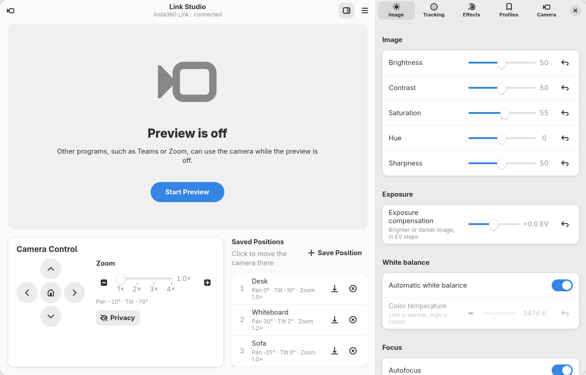
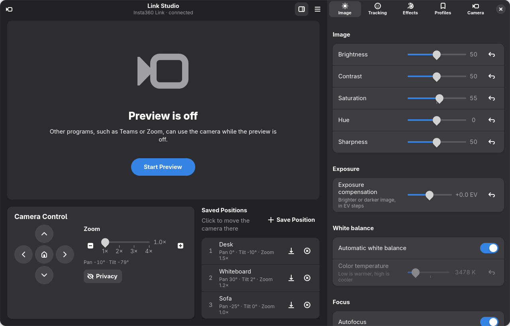
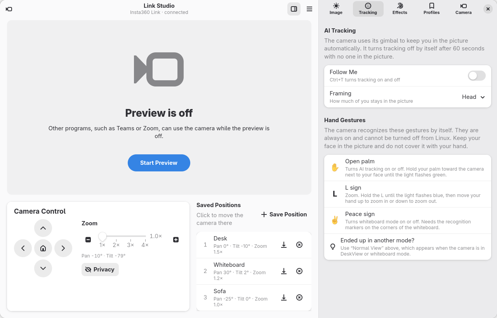
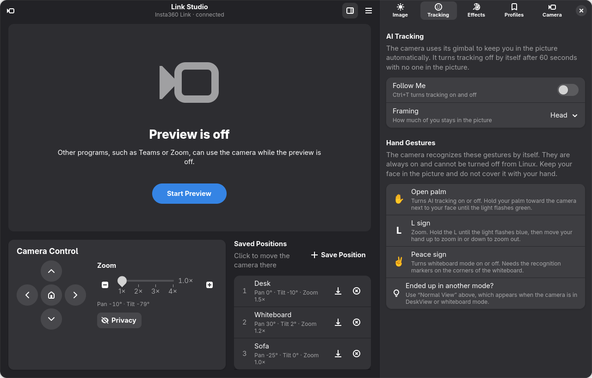
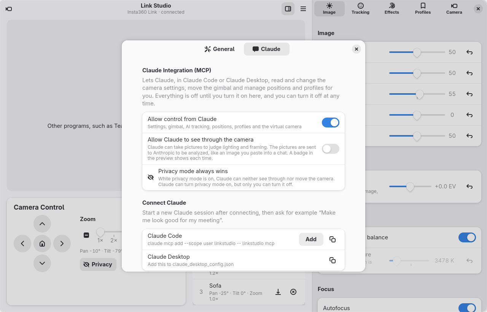
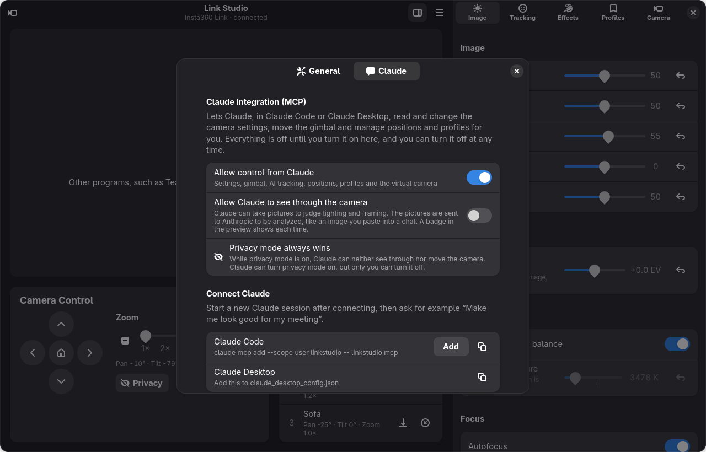

# Link Studio – Insta360 Link control for Linux

<p align="center">
  <picture>
    <source media="(prefers-color-scheme: dark)" srcset="docs/screenshots/image-dark.png">
    
  </picture>
</p>

Link Studio is a native Linux control panel for the **Insta360 Link** webcam. Insta360's own Link
Controller only exists for Windows and macOS; Link Studio brings its features to Linux – and adds a few
of its own.

* **Native GTK 4 / libadwaita interface** that fits into GNOME, follows the light/dark theme and also
  runs on KDE Plasma.
* **Live preview** in 720p, 1080p or 4K, with photos saved to `~/Pictures/Link Studio`.
* **Gimbal control**: pan, tilt and zoom with buttons or the keyboard, saved positions, centering and a
  privacy mode that points the camera down.
* **AI tracking** with framing (head, upper body, full body), plus an overview of the camera's hand
  gestures.
* **Image settings**: exposure compensation, brightness, contrast, saturation, hue, sharpness, white
  balance, focus and anti-flicker – and **profiles** that can be applied whenever the camera connects.
* **Virtual camera** "Link Studio Camera" for Teams, Zoom, OBS and browsers, so the preview and a meeting
  can use the camera at the same time.
* **Status icon** with the virtual camera and AI tracking at hand; optionally keeps running there when
  the window is closed, and can start at login.
* **Claude integration (MCP)**, off by default: let Claude tune the picture and framing for you –
  optionally looking through the camera.
* English and Norwegian user interface, following the system language or chosen in the app.

*From Norway with Love ❤️*

> Link Studio is an independent project and is not affiliated with or endorsed by Insta360.
> Insta360 and Insta360 Link are trademarks of Arashi Vision Inc.

Made by **Jan Ivar Sørensen** using [Claude Code](https://claude.com/claude-code), Anthropic's AI coding
assistant – from working out the camera's vendor commands to the GTK interface, the virtual camera, the
status icon and the Claude integration.

## Screenshots

| Light | Dark |
|---|---|
|  |  |
|  |  |
|  |  |

## Requirements

* Linux with an Insta360 Link connected over USB
* GTK ≥ 4.14 and libadwaita ≥ 1.5 (e.g. Fedora 40+, Ubuntu 24.04+, openSUSE Tumbleweed, Arch)
* Rust ≥ 1.88 to build (the install script installs it if your distribution's version is recent enough;
  otherwise use [rustup](https://rustup.rs))
* Optional: the `v4l2loopback` kernel module for the virtual camera (Link Studio sets it up for you)
* Optional, GNOME only: the
  [AppIndicator and KStatusNotifierItem Support](https://extensions.gnome.org/extension/615/appindicator-support/)
  extension for the status icon

## Installation

```bash
git clone https://github.com/Vindihaaret/linkstudio.git
cd linkstudio
./install.sh
```

The script:

* installs missing build tools with your package manager (zypper, dnf, apt or pacman; asks for your
  sudo password only then),
* builds Link Studio and installs it for your user under `~/.local` – no root needed for the app itself,
* adds a menu entry and icons.

Start **Link Studio** from the application menu, or run `linkstudio`.

### Uninstall

Choose **Menu → Uninstall Link Studio …** in the app, or run:

```bash
./uninstall.sh           # removes the program, keeps settings
./uninstall.sh --purge   # also removes ~/.config/linkstudio
```

The app's own uninstaller can also remove the virtual camera setup and the Claude Code registration.
Photos you have taken stay in `~/Pictures/Link Studio`.

## Supported hardware

| Camera | USB ID | Status |
|---|---|---|
| Insta360 Link | `2e1a:4c01` | Tested (firmware 1.4.5.8) |
| Insta360 Link 2 / 2C | `2e1a:4c04` and others | Not tested – standard controls should work, vendor features may differ |

Standard UVC controls (image settings, pan/tilt/zoom) work through V4L2 on any of them. AI tracking,
exposure compensation and the live gimbal position use Insta360's vendor commands – see
[Camera notes](#camera-notes).

## Virtual camera

The virtual camera uses the `v4l2loopback` kernel module. The Effects tab sets it up with the
administrator password (through `pkexec`) and shows the progress, running
`data/setup-virtual-camera.sh`, which:

* installs the module (openSUSE, Debian/Ubuntu, Arch; Fedora via RPM Fusion),
* writes `/etc/modprobe.d/linkstudio-v4l2loopback.conf` and
  `/etc/modules-load.d/linkstudio-v4l2loopback.conf`,
* loads the module, creating `/dev/video42` named "Link Studio Camera".

`data/remove-virtual-camera.sh` (also offered in the Effects tab and when uninstalling) removes those two
files. The module package is left installed, since other programs such as OBS may use it.

While the virtual camera is on, closing the window hides it; choose **Quit** in the menu or the status
icon (Ctrl+Q) to stop.

## Status icon

Link Studio shows a status icon (StatusNotifierItem) with Show, Virtual camera, AI tracking and Quit. KDE
Plasma shows it out of the box; GNOME needs the
[AppIndicator extension](https://extensions.gnome.org/extension/615/appindicator-support/).

Under **Preferences → General → Window**:

* **Keep in the status icon when the window is closed** – closing the window leaves Link Studio in the
  status icon, ready to use. The camera is released while the window is hidden, so other programs can
  use it.
* **Start at login** – adds an autostart entry that runs `linkstudio --minimized`, which starts in the
  status icon without opening the window.

On KDE Plasma the app keeps its libadwaita (GNOME) look and its own title bar; light/dark and the accent
color are taken from Plasma through the desktop portal.

## Claude integration (MCP)

Link Studio includes an [MCP](https://modelcontextprotocol.io) server, so Claude (in Claude Code or
Claude Desktop) can work with your camera: read and change image settings, point the gimbal, turn AI
tracking on or off, and save positions and profiles. If you also let it see through the camera, it can
take a picture, judge lighting and framing, adjust, and check again – like a photographer getting you
ready for a meeting.

**Everything is off until you turn it on**, in Link Studio → Preferences → Claude, and can be turned off
again at any time:

* **Allow control from Claude** – settings, gimbal, AI tracking, positions, profiles and the virtual
  camera.
* **Allow Claude to see through the camera** – a separate permission for pictures.

### Privacy

* Pictures Claude takes are sent to Anthropic to be analyzed, the same as an image you paste into a chat.
  Only turn on "see through the camera" if you are comfortable with that.
* Every picture shows a **"Claude is looking"** badge in the preview and a notice (a desktop notification
  while the window is hidden). Every change Claude makes shows a notice too.
* **Privacy mode always wins:** while it is on, Claude can neither see through nor move the camera.
  Claude can turn privacy mode on, but only you can turn it off. Privacy mode is remembered across
  restarts.
* These rules are enforced by Link Studio itself, not by Claude or the MCP process, so they apply however
  Claude connects. Pictures are never stored by Link Studio.

### Connecting

Click **Add** under Preferences → Claude, or run:

```bash
claude mcp add --scope user linkstudio -- linkstudio mcp
```

For Claude Desktop, add this to `claude_desktop_config.json` (use the full path, e.g.
`/home/you/.local/bin/linkstudio`, if `~/.local/bin` is not on Claude Desktop's PATH):

```json
{ "mcpServers": { "linkstudio": { "command": "linkstudio", "args": ["mcp"] } } }
```

Start a new Claude session and ask, for example:

* "Make me look good for my meeting."
* "Is anything off with my camera picture?" – backlight, framing, clutter.
* "Save a position that shows the whiteboard."
* "Make a warmer profile for evening calls and use it automatically."

If Link Studio is not running, `linkstudio mcp` starts it, so you always see what Claude is doing. The
camera sleeps (gimbal parked) when nothing streams; Link Studio wakes it for Claude and lets it sleep
again 10 seconds after Claude's last request.

Tools: `get_status`, `take_snapshot`, `set_image_settings`, `reset_image_settings`, `move_gimbal`,
`center_gimbal`, `set_tracking`, `goto_position`, `save_position`, `save_profile`, `apply_profile`,
`set_virtual_camera`, `set_privacy`.

## Keyboard shortcuts

| Keys | Action |
|---|---|
| Ctrl + arrow keys | Move the camera |
| Ctrl + plus / minus | Zoom in / out |
| Ctrl + Home | Center the camera |
| Ctrl + 1–9 | Go to a saved position |
| Ctrl + T | AI tracking on/off |
| Ctrl + P | Preview on/off |
| Ctrl + S | Take a photo |
| F9 | Show/hide the settings |
| Ctrl + , | Preferences |
| Ctrl + Q | Quit |

## Troubleshooting

* **Teams/Zoom says the camera is busy** – the Link Studio preview is using it. Turn the preview off
  (Ctrl+P), or use the virtual camera so both can run at once.
* **"Link Studio Camera" does not show up in a program** – start Link Studio (with the virtual camera on)
  before choosing the camera in that program.
* **No status icon on GNOME** – install and enable the AppIndicator extension.
* **AI tracking does not start right away** – the gimbal needs a couple of seconds to wake up when the
  camera starts streaming; Link Studio retries until the camera confirms tracking.

## Files

| Path | Contents |
|---|---|
| `~/.local/bin/linkstudio` | The program |
| `~/.config/linkstudio/config.json` | Settings, saved positions and profiles |
| `~/.config/autostart/io.github.linkstudio.LinkStudio.desktop` | Start at login (when turned on) |
| `~/Pictures/Link Studio/` | Photos |
| `/etc/modprobe.d/linkstudio-v4l2loopback.conf`, `/etc/modules-load.d/linkstudio-v4l2loopback.conf` | Virtual camera setup |

## Translations

English is the source language. Translations are gettext catalogs in `po/` and are embedded into the
binary at build time; the language follows the desktop locale (`LANGUAGE`, `LC_MESSAGES`, `LANG`) or the
choice in Preferences.

```bash
./po/update-po.sh              # refresh po/linkstudio.pot and merge into all .po files
cp po/linkstudio.pot po/de.po  # start a new language, then fill in msgstr
```

To try a language from a terminal: `LANGUAGE=nb linkstudio`.

## Development

```bash
cargo run                      # run from the source tree
cargo clippy                   # lint
linkstudio mcp                 # the MCP server (normally started by Claude)
```

`LINKSTUDIO_SCREENSHOT=out.png LINKSTUDIO_PAGE=tracking linkstudio` renders the window (optionally a
sidebar page, `preferences`, `preferences-claude` or `about`) to a PNG and quits – GNOME on Wayland does
not let other programs capture windows. The screenshots in `docs/screenshots` were made this way with the
preview off.

## Camera notes

The vendor features use the camera's UVC extension unit 9 (GUID `faf1672d-b71b-4793-8c91-7b1c9b7f95f8`),
first mapped by
[vrwallace/Insta360-Link-1-and-2-Controller-for-Linux](https://github.com/vrwallace/Insta360-Link-1-and-2-Controller-for-Linux).
On firmware 1.4.5.8:

* The mode selector reads back `0xff` after a mode command and `0x01` once tracking runs; Link Studio
  checks it and resends while the waking gimbal ignores the command. Changes made by hand gesture are
  reported properly, so the switch follows the palm gesture.
* The camera drops AI tracking whenever its video stream stops; Link Studio turns it back on when its own
  stream starts again.
* When nothing streams, the camera sleeps with the gimbal parked and ignores moves, so Link Studio wakes
  it first. The vendor "reset gimbal" command is not obeyed from every position, so centering also sets
  pan and tilt. Tilt physically stops at about −45°, short of the range V4L2 reports.
* Group tracking (unit 10, selector 1) is read-only, so that option is hidden.
* Selector 9 is exposure compensation: signed 16-bit little-endian, about 256 per EV. Its
  GET_MIN/GET_MAX replies are not usable. The value survives stream restarts.
* uvcvideo caches the V4L2 pan/tilt values, so moves made by AI tracking are invisible there.
  Selector 26 holds the live position as (tilt, pan) in arcsec and is used instead.
* The driver reports autofocus *off* as its default; Link Studio's "reset" turns automatic modes on.
* No live zoom value was found, so zoom changed with the "L" gesture is not reflected in the zoom slider.
* Writing selector 17 made the camera reset and re-enumerate. Selector 7 stops tracking when written, but
  did not measurably change tracking speed.

## License

Copyright © 2026 Jan Ivar Sørensen

Link Studio is free software: you can redistribute it and/or modify it under the terms of the
[GNU General Public License](LICENSE) as published by the Free Software Foundation, either version 3 of
the License, or (at your option) any later version.

Link Studio is distributed in the hope that it will be useful, but WITHOUT ANY WARRANTY; without even the
implied warranty of MERCHANTABILITY or FITNESS FOR A PARTICULAR PURPOSE. See the GNU General Public License
for more details.
